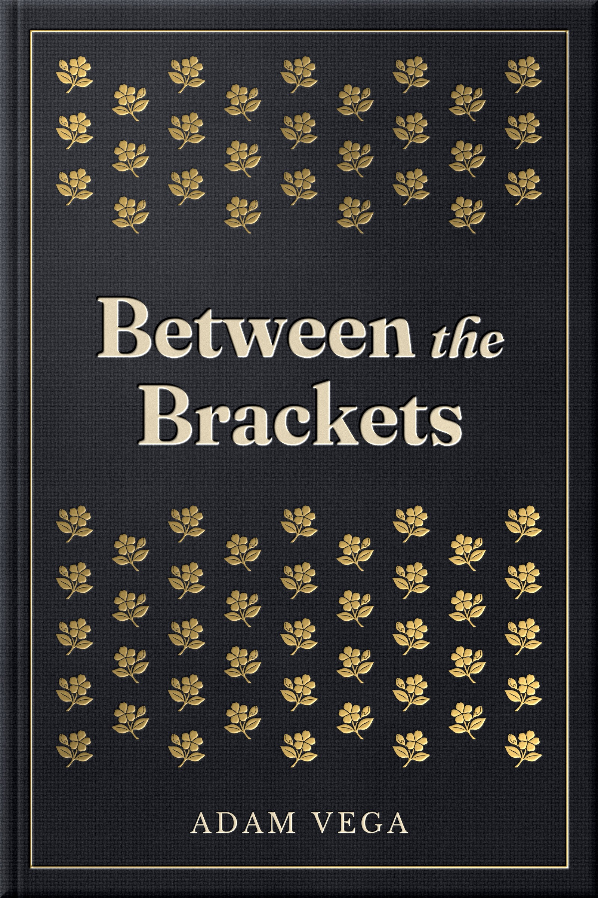

# Between the Brackets

*A Primer on Manuscript Families and Why English Bibles Differ*

**Student Edition**

Adam Vega

---

## Contents

- To the Reader
- **Part One: The King James Version**
  - Chapter 1: What Is Different
  - Chapter 2: Copied by Hand
  - Chapter 3: The First Printed Greek New Testaments
  - Chapter 4: Making the King James Version
- **Part Two: From the King James to the ESV**
  - Chapter 5: Old Manuscripts Come to Light
  - Chapter 6: Westcott, Hort, and Burgon
  - Chapter 7: Discoveries of the 1900s
  - Chapter 8: From the RSV to the ESV
- **Part Three: The Passages**
  - Chapter 9: The Ending of Mark
  - Chapter 10: The Woman Caught in Adultery
  - Chapter 11: The Three Witnesses in Heaven
  - Chapter 12: The Missing Verses
  - Chapter 13: Smaller Differences in Both Directions
- **Part Four: Reading the Same Evidence**
  - Chapter 14: Four Views
  - Chapter 15: Reading Your Bible's Notes
- Words to Know
- A Note on Sources
- For Further Reading

---

## To the Reader

Open an English Standard Version (ESV) to Matthew 17. Read verse 20, then look for verse 21. You won't find it. The numbers jump from 20 to 22. Now turn to the end of Mark. You will find twelve verses inside double brackets, with a note saying that some of the earliest manuscripts do not include them. Open a King James Version (KJV) to the same places. The text runs on with no gaps and no brackets.

This book explains why. It tells how the King James Version was made in the early 1600s. It tells how the English Standard Version was made around the year 2000. And it tells what happened in the four hundred years between them. You will meet the evidence, the people who studied it, and the reasons they gave for their choices.

This book does not try to prove that one Bible is better than the other. Christians who read the KJV and Christians who read the ESV both believe that God has spoken in Scripture. They disagree about which exact words belong in the New Testament and how we can know. That disagreement has a history, and this book tells it. Where the evidence leaves a question open, this book leaves it open too.

## Part One: The King James Version

### Chapter One: What Is Different

Read the ESV and the KJV side by side, and you will find differences. Some are long, and some are only one word. The two longest are whole passages. The first is Mark 16:9–20, the last twelve verses of Mark. These verses tell how the risen Jesus appeared to his followers, sent them out to preach, and was taken up into heaven. The second is John 7:53–8:11, the story of the woman caught in adultery. The ESV prints both passages, but it puts double brackets around them. Above Mark 16:9 it says, "Some of the earliest manuscripts do not include 16:9–20." Above John 7:53 it says, "The earliest manuscripts do not include 7:53–8:11." Notice that the two notes are worded differently. Chapters 9 and 10 look at the evidence behind the difference.

In sixteen places, the ESV skips a verse number. It puts a translation of the missing verse in a footnote instead. The sixteen are Matthew 17:21; 18:11; 23:14; Mark 7:16; 9:44; 9:46; 11:26; 15:28; Luke 17:36; 23:17; John 5:4; Acts 8:37; 15:34; 24:7; 28:29; and Romans 16:24.

Many ESV verses are also shorter than the KJV's. They leave out a phrase, and a footnote usually says, "Some manuscripts add..." The best-known example is the end of the Lord's Prayer in Matthew 6:13: "For thine is the kingdom, and the power, and the glory, for ever. Amen." The ESV puts these words in a footnote.

In other places the two Bibles use different words. In 1 Timothy 3:16, the KJV says "God was manifest in the flesh." The ESV says "He was manifested in the flesh." In Revelation 22:19, the KJV says "the book of life." The ESV says "the tree of life."

One passage changes with no footnote at all. In 1 John 5:7–8, the KJV says, "For there are three that bear record in heaven, the Father, the Word, and the Holy Ghost: and these three are one. And there are three that bear witness in earth, the Spirit, and the water, and the blood: and these three agree in one." The ESV says, "For there are three that testify: the Spirit and the water and the blood; and these three agree."

Sometimes the ESV keeps words even though its own Greek text doubts them. Luke 22:43–44 tells how an angel strengthened Jesus in the garden and how his sweat fell like drops of blood. The ESV prints these verses with a footnote: "Some manuscripts omit verses 43 and 44."

The differences also go the other way. Sometimes the ESV has words the KJV does not have. In 1 John 3:1, the ESV adds "and so we are." In John 1:18, where the KJV says "the only begotten Son," the ESV says "God the only Son." (ESV printings from before 2025 say "the only God.") In Jude 5, where the KJV says "the Lord," the ESV says "Jesus." Chapter 13 looks at these.

The Bible's writers did not number their verses. A printer named Robert Estienne (ay-TYEN), also called Stephanus, added verse numbers to the New Testament in 1551. The Geneva New Testament brought his numbers into English in 1557, and the full Geneva Bible followed in 1560. English Bibles have used them ever since. Commentaries, concordances, and sermons all depend on them. Later, scholars decided that some verses in Estienne's Greek text were added by copyists long after the New Testament was written. Translators did not want to renumber the whole Bible, so they left those numbers empty. A missing verse number in the ESV marks a place where the Greek text printed in the 1500s and the Greek text printed today disagree.

The differences start with the Greek. The KJV translators used Greek New Testaments printed between 1516 and 1598. These printed editions later came to be called the *Textus Receptus* (TEX-tus re-SEP-tus), which is Latin for "received text." The ESV translators used modern Greek texts. Those texts were built from many old manuscripts that the KJV translators never saw. Every printed Greek text has its own history, too. Each one depends on which manuscripts its editors could find and how they chose between them. Translators also decide how to show readers where the evidence is uncertain. The KJV of 1611 did this with a few notes in the margin about the Greek copies. The ESV does it with brackets and footnotes.

The differences have been counted. Scholars with the STEPBible project at Tyndale House in Cambridge, England, built a database that lines up eight printed Greek New Testaments word by word, including the KJV's Greek text and the ESV's. A summary in the database counts about 142,000 Greek words. About 133,600 of them, or 94 percent, are the same in all eight editions, apart from spelling. About 4,200 words appear in the KJV's Greek text but not in the ESV's. About 2,350 of those would change an English translation. About 900 words go the other way. They appear in the ESV's Greek text but not in the KJV's. These numbers show how much is in question. They do not tell us which text is right.

A few special words come up often in this book. A *manuscript* is a copy written by hand. A *variant* is a place where manuscripts disagree, and each different wording there is called a *reading*. The careful study of manuscripts to find the earliest wording is called *textual criticism*. In this phrase, "criticism" means careful judgment about evidence. A *critical text* is a Greek New Testament that editors build by comparing many manuscripts. The *Byzantine* (BIZ-un-teen) *text*, also called the *Majority Text*, is the form of the Greek New Testament found in most surviving manuscripts. Most of these were copied in the Greek-speaking world between about AD 800 and 1500. These words and others are also listed under "Words to Know" at the back of this book.

### Chapter Two: Copied by Hand

The books of the New Testament were written in Greek between about AD 50 and 100. For the next fourteen hundred years, every copy was made by hand. The original documents, written by the apostles and their helpers, wore out or were lost long ago. Every manuscript we have is a copy of a copy.

Try copying a book as long as Matthew by hand, and you will make mistakes. Ancient scribes did too. No two handwritten copies of a long book are exactly alike.

The earliest copies were written on *papyrus* (puh-PIE-rus), a kind of paper made from a reed that grew in Egypt. Christians liked to use the *codex*, a book with folded pages, instead of a scroll. Starting in the 300s, the best copies were made on parchment, which is made from animal skin. Until about AD 800, scribes wrote in all capital letters, with no spaces between words. Imagine reading a whole page that looked like THISISHOWTHEYWROTE. After about 800, scribes switched to a smaller, faster handwriting with lowercase letters.

A research institute in Münster, Germany, keeps the official list of Greek New Testament manuscripts. It lists more than 5,000. About 140 are papyri, and most of those are small pieces. The oldest come from the 100s and 200s. More than 300 are written in capital letters, mostly from the 300s through the 900s. Nearly 3,000 are in the smaller handwriting, from the 800s and later. About 2,500 are lectionaries, which are books of Bible readings for church services. Only a few dozen manuscripts contain the whole New Testament. Most were copied after the year 900.

A few very old manuscripts come up again and again in this book. Scholars give each one a name and a letter. Codex Vaticanus (B) was copied in the 300s and has been in the Vatican Library in Rome since at least the 1470s. Codex Sinaiticus, written with the Hebrew letter א (aleph), was also copied in the 300s. It is the oldest complete copy of the New Testament. Codex Alexandrinus (A) was copied in the 400s and came to England in 1627. Codex Ephraemi (C) was copied in the 400s too. In the Middle Ages, someone scraped off its Bible text and reused the pages for other writing, and scholars later recovered the Bible text underneath. Codex Bezae (D) was copied around 400. It has Greek on one page and Latin on the facing page.

Greek manuscripts are one kind of evidence. Early Christians also translated the New Testament into Latin, Syriac, and Coptic (the language of Egypt). These old translations show what Greek text their translators had in front of them. In 382, the bishop of Rome asked a scholar named Jerome to revise the Latin Gospels. Jerome's work became the center of the Latin Vulgate (VUL-gate), the Bible of Western Europe for a thousand years. Early Christian writers, called the church fathers, also quoted the New Testament often. Their quotations show what text was read in their time and place. However, they sometimes quoted from memory.

Most differences between manuscripts are accidents. A scribe's eye might jump from one word to the same word a few lines down and skip everything in between. Letters that looked alike got mixed up. Words got written twice. These mistakes are usually easy to spot, and they rarely change the meaning.

Some changes were made on purpose by scribes who thought they were fixing or explaining something. The most common is called *harmonization*. A scribe who knew a saying from one Gospel would change the same saying in another Gospel to match. Scribes also smoothed out grammar, added a name ("Jesus said" instead of "he said"), and added words used in church services. Sometimes a reader wrote a note in the margin. The next copyist might think the note belonged in the text and copy it in.

Several of the ESV's missing verses fit these patterns. Mark 9:44 and 9:46 repeat, word for word, a saying found in Mark 9:48: "where their worm dieth not, and the fire is not quenched." Matthew 18:11, "For the Son of man is come to save that which was lost," is almost the same as Luke 19:10. Luke 17:36, "Two men shall be in the field; the one shall be taken, and the other left," matches Matthew 24:40.

People read these facts in two ways. Some scholars think the verses were copied in from the similar passages. Others think the Gospel writers simply repeated themselves, the way a teacher repeats an important lesson. Both sides look at the same evidence. They weigh it differently.

Copies made in the same region tend to share the same readings, because copyists used the books near them. Scholars sort manuscripts into groups called *text-types*. The Alexandrian text is linked to Egypt. It is found in Vaticanus, Sinaiticus, and many papyri, and it tends to be shorter and less polished. The Western text is found in Codex Bezae, early Latin translations, and some early church fathers. It often adds words or rephrases them, especially in Acts. The Byzantine text is found in most later Greek manuscripts. It tends to be fuller and smoother. In it, similar passages often match, and hard phrases are often made easier.

The Byzantine text became the most common for reasons of history. After the 300s, most Christians in Western Europe read the Bible in Latin. In the 600s, Egypt and Syria came under Muslim rule. Most Greek copying then took place in the Byzantine Empire, centered in Constantinople (today's Istanbul). The manuscripts copied there after about 800 mostly agree with each other. Meanwhile, Egypt's dry climate preserved old papyri that rotted away everywhere else. That is why so many of the oldest manuscripts come from Egypt.

What these facts mean is the biggest question in this whole subject. One group of scholars says the older Egyptian manuscripts are closer to what the apostles wrote, and that the Byzantine text grew longer and smoother over time. Another group says the Byzantine text is the text the Greek-speaking church received and kept, and that the Egyptian manuscripts survived only because of the dry climate. The rest of this book follows the history of that disagreement.

### Chapter Three: The First Printed Greek New Testaments

Johannes Gutenberg printed the Bible in Latin around 1455. The Greek New Testament was not printed for another sixty years. Western Europe used the Latin Bible, few scholars knew Greek, and Greek type for printing was hard to find.

The first Greek New Testament sold to the public was made by Desiderius Erasmus (ih-RAZ-mus), the most famous scholar in Europe. A printer in Basel, Switzerland, published it in March 1516. (A Greek New Testament had already been printed in Spain in 1514, as part of a large Bible in several languages. But it was not sold until about 1522.) Erasmus worked fast. He used about six manuscripts that he could find in Basel. Most were Byzantine manuscripts copied in the 1100s or later.

For the book of Revelation, Erasmus had only one manuscript, and its last page was missing. It stopped before Revelation 22:16. To fill the gap, Erasmus translated the last six verses from the Latin Bible back into Greek. This created some readings that almost no Greek manuscript has. One of them is in the KJV at Revelation 22:19: "God shall take away his part out of the book of life." Nearly all Greek manuscripts say "tree of life" here. Scholars think the word "book" came from Latin copies where *ligno* ("tree") had been miscopied as *libro* ("book").

Erasmus also brought some Latin wording into the book of Acts. In Acts 9:5–6, the KJV reads, "it is hard for thee to kick against the pricks. And he trembling and astonished said, Lord, what wilt thou have me to do?" These words are in the Latin Bible, but nearly all Greek manuscripts lack them at this spot. (The saying about the pricks does appear in every text at Acts 26:14, where Paul retells the story.)

In Acts 8:37, Erasmus included the Ethiopian official's confession: "I believe that Jesus Christ is the Son of God." He said he found the verse written in the margin of one Greek manuscript. It was also in the Latin Bible, and he believed scribes had left it out by mistake. Most Greek manuscripts do not have it. However, a Christian writer named Irenaeus (eye-ren-AY-us) quoted the confession around AD 180. So some Christians knew it very early.

Erasmus revised his Greek New Testament four times. Martin Luther used Erasmus's 1519 edition to translate the New Testament into German. William Tyndale used later editions to translate it into English.

#### The three witnesses in heaven

The best-known change in Erasmus's work involves 1 John 5:7–8. His first two editions, in 1516 and 1519, did not include the words about "three that bear record in heaven, the Father, the Word, and the Holy Ghost." No Greek manuscript he had seen contained them. But the words were in the Latin Bibles of his day, and some critics attacked him for leaving them out. Then a Greek manuscript with the words turned up in England. It had been copied in the early 1500s. Erasmus added the words to his third edition in 1522. In his notes, he said he did this so no one could slander him. He also said he suspected the manuscript had been changed to match the Latin.

You may hear a story that Erasmus promised to add the words if anyone could show him just one Greek manuscript that had them. Historians have found no such promise in his writings. The main facts stand without the story. The words entered the printed Greek New Testament in 1522, from a manuscript copied that same century. Every later edition of the Textus Receptus kept them.

#### The received text

Robert Estienne, a printer in Paris, printed Greek New Testaments in 1546, 1549, and 1550. His 1550 edition followed Erasmus closely. It was the first to list different readings from manuscripts in its margins. In 1551, Estienne printed the edition that first divided the New Testament into numbered verses. In England, his 1550 text became the standard Greek New Testament for three hundred years.

Theodore Beza, who led the church in Geneva after John Calvin, published several editions between 1565 and 1604. Beza owned two ancient manuscripts, including Codex Bezae, but he used them very little. His editions of 1588–89 and 1598 were the Greek texts the King James translators used most.

In 1633, a printing company in the Netherlands published a Greek New Testament with a bold claim in its preface: "You have therefore the text now received by all." That sentence gave us the name *Textus Receptus*, the "received text." Today people use the name for the whole family of printed editions from Erasmus to 1633.

The Textus Receptus is mostly a Byzantine text, because Erasmus's manuscripts were mostly Byzantine. But it does not match the Byzantine majority everywhere. In some places it disagrees with most Greek manuscripts and with the ESV's Greek text too. You have already met several of them: Acts 8:37, which Erasmus printed from one Greek margin and the Latin Bible; the words in Acts 9:5–6, which he took from the Latin; the three witnesses in 1 John 5:7–8; and "the book of life" in Revelation 22:19. Acts 15:34, "Notwithstanding it pleased Silas to abide there still," is found in only a small number of Greek and Latin copies, and part of Acts 24:6–8 is found in a small number of Greek copies. The phrase "through his blood" in Colossians 1:14 matches Ephesians 1:7 and is found in only a few late copies. Luke 17:36 shows the printed editions disagreeing with each other. Erasmus and Estienne's 1550 edition leave the verse out. Estienne's 1551 edition and Beza's include it. This point comes back in Chapter 14.

### Chapter Four: Making the King James Version

The King James Version had many English Bibles before it. In the 1380s, followers of John Wycliffe translated the Bible into English from Latin. In 1526, William Tyndale printed the first English New Testament translated from Greek. He was executed for his work in 1536. Other English Bibles followed, including the Great Bible of 1539, which was placed in English churches. In 1560, English Protestants living in Geneva produced the Geneva Bible. It had verse numbers and many notes in the margins, and it became the favorite Bible of English families. The bishops of the Church of England made their own version, the Bishops' Bible (1568), which was read in churches.

In 1603, King James VI of Scotland also became King James I of England. In January 1604, he held a meeting with church leaders at Hampton Court Palace. A scholar named John Rainolds suggested a new translation of the Bible, and the king agreed. James disliked the Geneva Bible. He thought some of its notes encouraged people to disobey kings. He wanted a Bible without such notes that could be read in every church.

Richard Bancroft, who soon became Archbishop of Canterbury, organized the work and gave the translators fifteen rules. (In these quotations, the spelling has been updated.) The first rule said the Bishops' Bible was "to be followed, and as little altered as the truth of the original will permit." Another rule allowed them to use earlier translations, such as Tyndale's and the Geneva Bible, when those agreed better with the original. Another rule allowed notes in the margin only to explain Hebrew or Greek words.

About fifty scholars worked in six teams, called companies. Two met at Westminster in London, two at Oxford University, and two at Cambridge University. The Westminster companies translated Genesis through 2 Kings and the letters from Romans to Jude. The Cambridge companies took 1 Chronicles through the Song of Solomon, and also the Apocrypha. The Oxford companies took the prophets from Isaiah to Malachi, and the Gospels, Acts, and Revelation. When a company finished a book, it sent its work to the other companies to review. In 1610, a smaller group met in London to review the whole Bible. Notes from that meeting still exist. They show the translators arguing over single Greek words. The king's printer published the new Bible in 1611 as a large book for church pulpits. Its title page said it was "Appointed to be read in Churches." Over time, people called it the Authorized Version.

#### What the translators worked from

For the Old Testament, the translators used printed Hebrew Bibles. For the New Testament, they used the printed Greek editions of Beza and Estienne. When those editions disagreed, the translators chose between them, usually following Beza. No single printed Greek text matched all their choices until a scholar named F. H. A. Scrivener rebuilt one in 1881 and 1894. Scrivener's text is the Textus Receptus that people print today.

The translators knew that manuscripts sometimes disagreed. At Luke 17:36, the margin of the 1611 KJV says, "This 36. verse is wanting in most of the Greek copies." ("Wanting" means "missing.") At Matthew 26:26, the text says Jesus "blessed" the bread, and the margin says, "Many Greek copies have, gave thanks." The printed Greek editions disagreed about Luke 17:36, and the translators followed Beza, who included it. They kept the reading in Matthew too, and they told their readers what they knew.

But they could not know what later scholars would find. Codex Alexandrinus did not reach England until 1627. Codex Vaticanus was locked away in Rome. Codex Sinaiticus sat unnoticed in a monastery near Mount Sinai until 1844. None of the oldest papyri had been discovered.

The translators wrote a long preface called "The Translators to the Reader." It explains their goal: "we never thought from the beginning that we should need to make a new translation, nor yet to make of a bad one a good one, ... but to make a good one better." It also defends their notes in the margin, agreeing with Augustine that "variety of translations is profitable for the finding out of the sense of the Scriptures." ("Profitable" here means "helpful.") And they wrote that even "the very meanest translation of the Bible in English ... containeth the word of God, nay, is the word of God." ("Meanest" here means "poorest in quality.")

The 1611 KJV included the Apocrypha (uh-POK-ruh-fuh), a group of books found in the Greek and Latin Old Testament but not in the Hebrew Bible. They were printed in a separate section between the Old and New Testaments. The Church of England read them as examples of good living and did not use them to set doctrine. In 1826, a major Bible society decided to stop paying for Bibles that included them. Most KJVs since then have left them out. Which books belong in the Bible is a different question from which words belong in those books. This book is about the second question.

The KJV most people read today comes from a 1769 edition by Benjamin Blayney of Oxford. His revision fixed printing errors, updated spelling, and made the italic words consistent. (Italics in the KJV mark English words the translators added to make the meaning clear.) These changes affected only the English. The Greek and Hebrew behind it stayed the same. By about 1700, the KJV had replaced the Geneva Bible. For three hundred years, it was the English Bible.

## Part Two: From the King James to the ESV

### Chapter Five: Old Manuscripts Come to Light

After 1611, scholars kept finding and comparing manuscripts. In 1627, Codex Alexandrinus arrived in England as a gift to King Charles I. It was the first very old manuscript that English scholars could study closely. In the 1650s, a scholar named Brian Walton printed a list of its different readings.

This started an argument. John Owen, a famous Puritan pastor, worried that long lists of variants would shake people's trust in the Bible. He agreed that copyists had made mistakes in some copies. But he believed God had kept the text safe in the copies the church already had. Walton replied that studying the variants helped defend the Bible. Both men believed in the authority of Scripture. They disagreed about what the variants meant and what to do with them. Christians have argued about that question ever since.

John Mill of Oxford spent about thirty years comparing manuscripts, early translations, and quotations from the church fathers. In 1707 he published a Greek New Testament with a list of the variants he had found. People counted about 30,000. Some critics of Christianity used that number to argue that the Bible could not be trusted. A scholar named Richard Bentley answered them. He said the number of variants grows as more manuscripts are studied. Most variants are tiny, he said, and a book with many copies can be checked better than a book with few.

Scholars also began to write down rules for choosing between readings. In 1734, a German Lutheran pastor named Johann Bengel suggested one of the most famous rules: the harder reading is usually the original. His reason was that scribes were more likely to make a hard passage easier than to make an easy passage harder. In 1796, another German scholar, Johann Griesbach, wrote that the shorter reading is usually the original, because scribes added words more often than they left them out. Scholars still discuss these rules today.

In 1831, Karl Lachmann of Berlin published the first Greek New Testament that set the Textus Receptus aside completely. He built his text from the oldest manuscripts he could find.

Constantin von Tischendorf (TISH-en-dorf) spent his life hunting for manuscripts. In 1844, at St. Catherine's Monastery near Mount Sinai, he obtained 43 leaves (86 pages) from the Old Testament part of a very old Greek Bible. When he returned in 1859, the monks showed him the rest of it, including the whole New Testament. This was Codex Sinaiticus. It was given to the Russian czar and published in 1862. People still disagree about whether the monastery agreed to give it away. Most of it is now in the British Library in London.

Codex Vaticanus had been in the Vatican Library for four hundred years, but few scholars were allowed to study it. Its full text became available step by step between 1857 and 1890.

By 1870, most leading scholars agreed that the oldest manuscripts often differed from the Textus Receptus, and that where they differed, the oldest manuscripts were usually closer to the original. A few scholars disagreed, and their objections come up in the next chapter.

### Chapter Six: Westcott, Hort, and Burgon

In 1870, the Church of England decided to revise the King James Version. The scholars working on the New Testament included two professors from Cambridge University, Brooke Foss Westcott and Fenton John Anthony Hort. Their rules told them to change the KJV's English as little as faithfulness allowed. For the Greek text, they were to follow the readings with the strongest evidence. The Revised New Testament came out on May 17, 1881, and sold in huge numbers. The full Revised Version appeared in 1885. An American edition, the American Standard Version, followed in 1901.

Westcott and Hort had been building their own Greek text since 1853, and they shared it with the other translators. They published it in 1881, and Hort explained their method in a long introduction.

Hort began with a rule: know the manuscripts before choosing a reading. A scholar should first learn which manuscripts are usually reliable. Hort also argued that a family of manuscripts counts only once. If a hundred manuscripts were all copied from one older manuscript, together they count as one witness. So the number of manuscripts that support a reading does not prove it is right. Hort sorted manuscripts into groups and thought the best group was the one found in Vaticanus and Sinaiticus.

He believed the Byzantine text came later than the others. He argued that it often joined two older readings into one. For example, in Luke 24:53, some old manuscripts say the disciples were in the temple "blessing God," and others say "praising God." The Byzantine text, which the KJV follows, says "praising and blessing God." Hort also argued that readings found only in the Byzantine text do not show up in Christian writers before about AD 350.

Hort had strong opinions. In a private letter written in 1851, when he was 23, he called the Textus Receptus "that vile Textus Receptus leaning entirely on late MSS." (MSS is short for "manuscripts.") Defenders of the Textus Receptus often quote this letter to show that Hort was biased. Hort's defenders answer that his arguments should be judged by their evidence.

#### Burgon's answer

The strongest opponent of Westcott and Hort was John William Burgon (BUR-gun), an English church leader. In 1871 he wrote a whole book defending the last twelve verses of Mark. In 1883 he published *The Revision Revised*, a sharp attack on the new Greek text.

Burgon argued that the true text is the one supported by most manuscripts, early translations, and church fathers together, across many times and places. He believed Vaticanus and Sinaiticus were among the worst copies ever made. He thought they had survived because people set them aside as faulty, so they never wore out from use. He also argued that God would not let the true text stay hidden in a few manuscripts for fifteen hundred years.

The Revised Version never replaced the KJV in English churches. But the Greek text behind it lasted. Through the American Standard Version and later Bibles, the choices made in 1881, updated by later discoveries, shaped most English translations of the 1900s.

### Chapter Seven: Discoveries of the 1900s

In the 1900s, scholars found evidence that Westcott and Hort never saw. Starting in 1896, digs at an ancient Egyptian town called Oxyrhynchus (ox-ee-RINK-us) uncovered thousands of papyrus documents, including pieces of the New Testament. In the 1930s, a collector named Chester Beatty bought three papyrus books from the 200s, including a copy of Paul's letters from around AD 200. In the 1950s and early 1960s, papyri owned by the Bodmer Library in Switzerland were published. They included copies of John and of Luke from around 200.

One of those papyri, called P75, changed the debate. It contains much of Luke and John. Most scholars date it around AD 200, though some think it is later. Its text is almost the same as the text of Codex Vaticanus. That means the kind of text found in Vaticanus already existed, and was being copied carefully, long before Vaticanus itself was made.

Other discoveries challenged parts of Hort's theory. Hort knew the Western text was very old, but he thought it was careless. Later scholars gave its early readings more weight. They found no historical record of the official revision that Hort believed had produced the Byzantine text. And some readings once thought to belong only to the Byzantine text turned up in early papyri. Today, scholars agree that a Byzantine reading may be early or late. They weigh each reading on its own.

In 1898, a German scholar named Eberhard Nestle (NES-luh) published a small Greek New Testament for students. Later scholars, especially Kurt Aland (AH-lahnt), kept improving it. In 1966, the United Bible Societies (UBS) published a Greek New Testament made for Bible translators. Its notes rate how certain the editors are about each choice, from A (very certain) to D (quite uncertain). Bruce Metzger wrote a companion book that explains the reasons for their choices.

Today these two editions, called Nestle-Aland and UBS, print the same Greek text. As of 2026, the newest editions came out in 2012 and 2014, and a new edition is being prepared. The 2012 edition made about three dozen changes in the letters from James to Jude. Those changes came from a large project in Germany that uses computers to compare manuscripts. One change matters for this book. In Jude 5, the 2012 edition reads "Jesus" where the earlier edition read "the Lord." The ESV had already read "Jesus" since 2001, eleven years earlier. So the ESV translators sometimes choose a different reading from their Greek text.

Other modern Greek texts exist too, and their editors do not always agree. For example, a Greek New Testament published by Tyndale House in 2017 includes the words "and fasting" in Mark 9:29. The Nestle-Aland text leaves them out.

#### How scholars choose between readings

Today most scholars use a method called *reasoned eclecticism* (ek-LEK-tih-siz-um). "Eclectic" means choosing from many sources. The editors do not follow one manuscript or one family all the way through. Instead, they make a decision at each place where manuscripts disagree, using two kinds of evidence.

*Outside evidence* is about the manuscripts. Scholars ask how old they are, whether they come from different parts of the ancient world, and whether they are usually reliable. A reading found in early manuscripts from several regions is usually preferred.

*Inside evidence* is about the words themselves. Scholars ask what a scribe would likely have done. Scribes often made Gospel passages match, smoothed hard phrases, or added familiar words. So scholars look for the reading that best explains how the others came about. They also ask what the author was most likely to write, based on his style and his argument.

These rules require judgment, and scholars still debate them. For example, a 2008 study by James Royse found that the scribes who copied the earliest papyri left words out more often than they added them. That study raised questions about the rule that the shorter reading is usually the original. The A-to-D ratings exist because the editors know some of their decisions are more certain than others.

### Chapter Eight: From the RSV to the ESV

The ESV grew out of an earlier Bible called the Revised Standard Version (RSV). The RSV was a revision of the American Standard Version of 1901. Its New Testament came out in 1946, and the whole Bible came out in 1952. The first RSV New Testament put Mark 16:9–20 and John 7:53–8:11 in footnotes. A second edition in 1971 put both passages back into the main text.

Many conservative Christians criticized the RSV. Their biggest complaint was about Isaiah 7:14, where the RSV said "young woman" in place of the KJV's "virgin." That argument was about translation more than about the Greek text. It led evangelical publishers to make new Bibles, such as the New American Standard Bible (1971) and the New International Version (1978). The New King James Version (1982) updated the KJV's English but kept the Textus Receptus. Its footnotes show where the modern critical text and the Majority Text differ from it. The NKJV shows that a modern English Bible can be based on the Textus Receptus. So most of the differences in this book come from the Greek text behind each Bible.

In the 1990s, Lane T. Dennis, the president of a Christian publisher called Crossway, worked with a group of scholars to plan a new translation. They wanted it to follow in the tradition of the RSV and the KJV and to reflect evangelical beliefs. In 1998, Crossway received permission to use the 1971 RSV as a starting point. A committee of fourteen led the work, with J. I. Packer as general editor. More than fifty scholars reviewed the translation. The ESV was published in 2001. It has had small updates since then, in 2007, 2011, 2016, and 2025.

The ESV calls itself "essentially literal." That means it tries to translate word for word as much as good English allows. Its preface says the New Testament is translated from the Nestle-Aland and UBS Greek texts described in Chapter 7. It calls its footnotes "an integral part of the ESV translation."

From the modern Greek texts, the ESV received the shorter readings described in Chapter 1. From the 1971 RSV, it received the practice of printing the long passages in Mark and John in the main text while setting them apart.

#### How to read the ESV's brackets and footnotes

The ESV marks its choices in a few different ways. If you learn them, you can tell what the translators decided in each place.

1. Double brackets with a note mean the translators think a long passage was added later, though the passage is very old and has been read in churches for centuries. Only Mark 16:9–20 and John 7:53–8:11 are marked this way.
2. A missing verse number with a footnote means a whole verse was probably added later: "Some manuscripts insert verse 21: *But this kind never comes out except by prayer and fasting*" (note at Matthew 17:20).
3. A footnote that says "Some manuscripts add" means a phrase was probably added later: "some manuscripts add *For yours is the kingdom and the power and the glory, forever. Amen*" (Matthew 6:13).
4. A footnote that says "Some manuscripts omit" means the ESV kept words that some manuscripts leave out: "Some manuscripts omit verses 43 and 44" (Luke 22:44).
5. "Some manuscripts" followed by different wording means the translators chose between two readings: "Some manuscripts *although you fully knew it, that the Lord who once saved*" (Jude 5).
6. No note at all appears at 1 John 5:7–8.

Be careful with the phrase "some manuscripts." It can mean very different things. At Matthew 6:13, the "some manuscripts" that add the ending of the Lord's Prayer are actually most of the Greek manuscripts that exist. At Acts 8:37, they are a small number. A footnote tells you that a choice was made. It does not tell you how strong the evidence was. The next chapters look at the evidence for the most important passages.

## Part Three: The Passages

### Chapter Nine: The Ending of Mark

Mark 16:8 ends this way: "And they went out quickly, and fled from the sepulchre; for they trembled and were amazed: neither said they any thing to any man; for they were afraid." In the KJV, twelve more verses follow. Jesus appears to Mary Magdalene, to two disciples walking in the country, and to the eleven apostles. He sends them to preach the gospel to everyone, promises signs that will follow believers, and is taken up into heaven.

Most Greek manuscripts that contain the end of Mark have these verses. They include three important manuscripts from the 300s and 400s: Alexandrinus, Ephraemi, and Washingtonianus. Codex Bezae has the beginning of the passage too, though its original pages stop partway through verse 15. The passage also appears in most copies of the Latin, Syriac, and Coptic translations, though some of the oldest copies in these languages do not have it. Around AD 180, Irenaeus quoted Mark 16:19 and said that Mark wrote it. A combined telling of the four Gospels, made around 170 and called the *Diatessaron* (dye-uh-TESS-uh-ron), is now lost, but the later forms of it that survive include these verses. Churches in the East and the West read the passage for most of Christian history.

But the two oldest Greek manuscripts that contain the end of Mark, Vaticanus and Sinaiticus, stop at verse 8. In Vaticanus, the scribe left a whole column blank after verse 8. It is the only blank column in its New Testament. Some scholars think this means the scribe knew there was more text. The oldest Syriac manuscript, many Armenian manuscripts, and the oldest Georgian manuscripts also end at verse 8. In the early 300s, a church historian named Eusebius (yoo-SEE-bee-us) wrote that the accurate copies ended with "for they were afraid." He said the verses after it were missing from almost all copies.

There is also a third ending. A few manuscripts have a short ending of one or two sentences after verse 8. Several of them give the short ending first and then the long one. And some manuscripts that contain the longer ending include notes or marks saying that some copies leave it out.

Scholars who think the longer ending was added later point out that its words and style differ from the rest of Mark. They also notice that verse 9 introduces Mary Magdalene as if for the first time, even though she was already named in verse 1. Scholars who defend the longer ending answer that twelve verses are too few to judge an author's style. They argue that a Gospel is unlikely to end with frightened women saying nothing. They also point out that Irenaeus knew this ending within about a hundred years of the time Mark wrote. Among those who think the passage was added, some believe Mark meant to end at verse 8. Others believe Mark's real ending was lost.

The KJV prints the passage with no note. The ESV prints it in double brackets under the note "Some of the earliest manuscripts do not include 16:9–20." The word "some" matters. The two oldest Greek copies end at verse 8, but Irenaeus, who lived earlier than both, knew the longer ending.

### Chapter Ten: The Woman Caught in Adultery

John 7:53–8:11 tells how religious leaders brought a woman caught in adultery to Jesus. Jesus wrote on the ground and said, "He that is without sin among you, let him first cast a stone at her." After her accusers had left, he said, "Neither do I condemn thee: go, and sin no more."

This passage is missing from the two oldest manuscripts that contain this part of John, the papyri P66 and P75, both from around AD 200. It is also missing from Vaticanus and Sinaiticus. Alexandrinus and Ephraemi have lost their pages at this spot, but measuring the missing pages shows there was not enough room for the story. It is missing from the oldest Syriac and Coptic translations. And no Greek writer who wrote a commentary on John discusses it until the 1100s.

The passage does appear in Codex Bezae, from around 400, and in most later Greek manuscripts. It is also in the Latin Vulgate. Jerome, who included it, wrote that it was found "in many Greek and Latin manuscripts." Augustine thought some people had removed it because they feared it would seem to excuse sin. A church book from the 200s tells a story about Jesus refusing to condemn a sinful woman. And Papias, a church leader writing in the early 100s, knew a story about a woman accused of many sins before the Lord.

In the manuscripts that have the story, it shows up in different places. Most put it after John 7:52. Others put it after John 7:36, after 7:44, or at the very end of John. One group of manuscripts puts it in the Gospel of Luke, after Luke 21:38. Many manuscripts that include it mark it with signs of doubt.

Most scholars think the story is an early account about Jesus that was passed around on its own and later added to John's Gospel. Many of these scholars believe it really happened. Its wording sounds more like Luke than John. Defenders of the passage think it was removed from John. They point out that when Greek churches read John aloud at the feast of Pentecost, they skipped from 7:52 to 8:12. They suggest this custom may have led copyists to leave the story out. They also point to Augustine's comment.

The KJV prints the story with no note. The ESV prints it in double brackets under the note "The earliest manuscripts do not include 7:53–8:11." Compare this note with the one at Mark 16, which said "some of the earliest." The wording is stronger here, probably because every Greek manuscript older than Codex Bezae leaves the story out.

### Chapter Eleven: The Three Witnesses in Heaven

The ESV changes 1 John 5:7–8 without a footnote. In the KJV the passage reads like this. The words in bold are the ones the ESV does not have.

> For there are three that bear record **in heaven, the Father, the Word, and the Holy Ghost: and these three are one. And there are three that bear witness in earth,** the Spirit, and the water, and the blood: and these three agree in one.

Scholars call the bold words the *Comma Johanneum* (KOM-uh jo-han-NAY-um). The name means "the short phrase in John."

Only about ten Greek manuscripts have these words, and all of them were copied in the late Middle Ages or later. In several of them, a later person added the words in the margin. The oldest manuscript with the words in the main text was copied in the 1300s. No Greek church father ever quotes them. In the 300s, Greek-speaking Christians argued long and hard about the Trinity, and they quoted every verse they thought would help. They never quoted this one. Most scholars think that means they did not know it.

The words come from the Latin-speaking church. The first clear quotation of them is by a Spanish bishop named Priscillian (pri-SIL-ee-un) around AD 380. Around 250, a North African bishop named Cyprian (SIP-ree-un) wrote that it is written of the Father, Son, and Holy Spirit, "and these three are one." Scholars disagree about whether he was quoting these words or explaining verse 8 as a picture of the Trinity. The words spread through Latin Bibles in the Middle Ages, though the oldest copies of the Latin Vulgate do not have them. By the late Middle Ages, they were a normal part of the Latin Bible.

As you read in Chapter 3, Erasmus added the words to his third edition in 1522. Later editors kept them, and the KJV translators included them. Martin Luther's German New Testament did not include them while he was alive. The Revised Version of 1881 removed them, and so have most English translations since. The NKJV keeps them, with a footnote.

Some Christians still defend these words. They argue that the grammar of verse 8 makes more sense with them, that Cyprian may have known them, and that they could have been lost from the Greek by accident. Most scholars, including many who firmly believe in the Trinity, think the words began as a Latin explanation that was later copied into the text. The ESV has no footnote here, and its preface does not say why.

### Chapter Twelve: The Missing Verses

Here are the sixteen verses the ESV moves to footnotes. The table shows the KJV wording, whether the verse is in most Greek manuscripts (the Byzantine text), and a similar verse that a copyist might have borrowed from.

| Verse | KJV wording | In most MSS? | Similar verse |
|---|---|---|---|
| Matt 17:21 | Howbeit this kind goeth not out but by prayer and fasting. | Yes | Mark 9:29 |
| Matt 18:11 | For the Son of man is come to save that which was lost. | Yes | Luke 19:10 |
| Matt 23:14 | Woe unto you, scribes and Pharisees, hypocrites! for ye devour widows' houses... | Yes | Mark 12:40 |
| Mark 7:16 | If any man have ears to hear, let him hear. | Yes | Mark 4:23 |
| Mark 9:44, 46 | Where their worm dieth not, and the fire is not quenched. | Yes | Mark 9:48 |
| Mark 11:26 | But if ye do not forgive, neither will your Father which is in heaven forgive... | Yes | Matt 6:15 |
| Mark 15:28 | And the scripture was fulfilled, which saith, And he was numbered with the transgressors. | Yes | Luke 22:37 |
| Luke 17:36 | Two men shall be in the field; the one shall be taken, and the other left. | No | Matt 24:40 |
| Luke 23:17 | (For of necessity he must release one unto them at the feast.) | Yes | Mark 15:6 |
| John 5:4 | For an angel went down at a certain season into the pool, and troubled the water... | Yes | None |
| Acts 8:37 | And Philip said, If thou believest with all thine heart, thou mayest... | No | None |
| Acts 15:34 | Notwithstanding it pleased Silas to abide there still. | No | Acts 15:40 |
| Acts 24:7 | But the chief captain Lysias came upon us, and with great violence took him away... | No | Acts 21:31–36 |
| Acts 28:29 | And when he had said these words, the Jews departed, and had great reasoning among themselves. | Yes | None |
| Rom 16:24 | The grace of our Lord Jesus Christ be with you all. Amen. | Yes | Rom 16:20 |

Twelve of the sixteen verses are in most Greek manuscripts, and four are not. In the twelve, the oldest manuscripts and the majority of manuscripts disagree. Which reading a scholar chooses depends on which method that scholar trusts. In the other four, the KJV's Greek text disagrees with most manuscripts as well.

Some of these verses move around. Manuscripts that have Matthew 23:14 put it either before verse 13 or after it. Some manuscripts put Luke 23:17 after verse 19. Scholars who think these verses were added say a copyist adding a note from the margin had to guess where it went. Defenders answer that verses can get moved during copying without having been added.

John 5:4 explains that an angel stirred the water of a pool, and the first person to step in was healed. It is in Codex Alexandrinus and most later manuscripts, and a writer named Tertullian (ter-TUL-ee-un) knew about it around AD 200. It is missing from the oldest papyri, Vaticanus, and Sinaiticus. Defenders point out that in verse 7, the sick man says, "I have no man, when the water is troubled, to put me into the pool." They say this only makes sense if verse 4 is there. Others reply that verse 4 was added to explain verse 7.

Acts 8:37 is the Ethiopian official's confession of faith. It appears in one Greek manuscript from the 500s, in some later Greek manuscripts, and in Latin copies. Irenaeus knew it, too. But it is missing from the oldest Greek manuscripts and from most Greek manuscripts. Some scholars think it was added because the story moves straight from the official's question, "What doth hinder me to be baptized?" to his baptism, and early Christians expected a confession of faith before baptism.

### Chapter Thirteen: Smaller Differences in Both Directions

Most differences between the KJV and the ESV are smaller than a whole verse. They are a phrase or a single word. These smaller differences fall into the same two groups as the missing verses. In some places, the oldest manuscripts and most manuscripts disagree. In other places, the KJV's Greek text stands apart from both.

The ending of the Lord's Prayer in Matthew 6:13, "For thine is the kingdom, and the power, and the glory, for ever. Amen," is missing from Sinaiticus, Vaticanus, Bezae, and most early Latin copies. It is in most later Greek manuscripts. A few early translations have a shorter form of it. A very early church handbook called the *Didache* (DID-uh-kay), from around AD 100, ends the prayer with "for thine is the power and the glory for ever." That shows Christians ended the prayer with words of praise very early. Some scholars think these words came into Matthew from church worship. Others think Matthew wrote them and some copies dropped them.

In Luke 9:55–56, James and John want to call down fire on a Samaritan village. In the KJV, Jesus tells them, "Ye know not what manner of spirit ye are of. For the Son of man is not come to destroy men's lives, but to save them." The ESV, following the oldest manuscripts, says only that Jesus turned and rebuked them. Many later Greek manuscripts have the longer words, but not all of them do.

Some changes are only a word or two. In Mark 9:29, the KJV says "by prayer and fasting," and the ESV says "by prayer." Most Greek manuscripts have "and fasting," and so does the Tyndale House Greek New Testament, but Sinaiticus and Vaticanus do not. In Colossians 1:14, the KJV says "redemption through his blood," and the ESV says "redemption." Every manuscript has "through his blood" in Ephesians 1:7. In Colossians 1:14, though, the phrase is found only in the KJV's Greek text and a few late manuscripts.

The difference in 1 Timothy 3:16 comes down to two letters. The KJV says "God was manifest in the flesh." The ESV says "He was manifested in the flesh." In the old capital-letter handwriting, the Greek word for "God" was shortened to two letters, ΘΣ, with a line above them. The Greek word for "who" was written ΟΣ. The two look almost the same. A small line inside the first letter makes the difference. Most later manuscripts say "God." The oldest clear manuscripts, including Sinaiticus, say "who."

Sometimes the ESV's Greek text is the longer one, and sometimes its wording is even more direct about who Jesus is. In John 1:18, where the KJV says "the only begotten Son, which is in the bosom of the Father," the ESV says "God the only Son, who is at the Father's side." The reading "God" is found in P66, P75, Vaticanus, and Sinaiticus. The reading "Son" is found in Alexandrinus and most later manuscripts. In 2025 the ESV changed its wording from "the only God" to "God the only Son." Its Greek text still has "God" here. The words "only Son" translate one Greek word that means "one and only." In Jude 5, the KJV says that the Lord saved the people out of Egypt, and the ESV says that Jesus did. The ESV also adds "and so we are" to 1 John 3:1 and "into salvation" to 1 Peter 2:2.

Mark 1:2 is a good example of a hard reading. The KJV says, "As it is written in the prophets." The ESV says, "As it is written in Isaiah the prophet." The quotation that follows actually combines Malachi 3:1 with Isaiah 40:3. The oldest manuscripts name only Isaiah. Most later manuscripts say "in the prophets," which avoids the problem. Scholars see this as an example of a scribe making a hard reading easier.

#### The Old Testament

Both Bibles translate the Old Testament from the Hebrew Masoretic (mass-oh-RET-ik) text. The Masoretes were Jewish scholars who carefully copied the Hebrew Bible between about AD 500 and 1000. They added marks to show vowels and pronunciation. The KJV translators used printed Hebrew Bibles. The ESV uses a modern edition based on the Leningrad Codex, copied around 1008. It is the oldest complete Hebrew Bible. The two Hebrew texts differ very little.

The Dead Sea Scrolls, found starting in 1947, gave scholars Hebrew manuscripts about a thousand years older. The Great Isaiah Scroll agrees very closely with the Masoretic text of Isaiah. In some other places, the scrolls agree with the Septuagint (sep-TOO-uh-jint), an ancient Greek translation of the Old Testament.

In a few places, the ESV follows these older sources and has more than the KJV. Psalm 145 is an acrostic: each verse starts with the next letter of the Hebrew alphabet. But the Masoretic text skips the verse for the letter *nun*. The ESV adds it at the end of verse 13: "The LORD is faithful in all his words and kind in all his works." This line comes from one Hebrew manuscript, the Septuagint, a Syriac translation, and a Dead Sea Scroll.

## Part Four: Reading the Same Evidence

### Chapter Fourteen: Four Views

Most of the facts in this book are not seriously disputed. What they mean is disputed. Christians who believe the Bible is God's Word read these facts in different ways, and each way explains the differences between the ESV and the KJV for itself.

The view called *reasoned eclecticism* belongs to the editors of today's major Greek New Testaments. It is also the view of the translators of most modern English Bibles, including the ESV, NIV, NASB, CSB, and NRSV. It says that no manuscript or family of manuscripts is perfect, so each variant must be judged on its own. The oldest manuscripts are usually closest to the original, though not always. According to this view, the ESV brackets or leaves out the passages in this book because the evidence shows they were added during copying. People who hold this view believe the text is certain in the great majority of places and uncertain in a small number. Many evangelical Christians who hold it believe God has preserved his Word through all the surviving manuscripts together. B. B. Warfield, who taught at Princeton Seminary and strongly defended the Bible's accuracy, held an early form of this view.

The view called *Byzantine priority* says the original text is best preserved in the form found in most Greek manuscripts. Its supporters argue that the Greek-speaking church copied the text for many centuries and in many places. They believe that history is better evidence than a few early copies that survived because Egypt is dry. They also argue that Hort's case against the Byzantine text was wrong. Scholars who hold this view have published Greek New Testaments based on the majority of manuscripts. According to this view, Mark 16:9–20, John 7:53–8:11, the ending of the Lord's Prayer, and twelve of the sixteen missing verses belong in the Bible. But Acts 8:37, Luke 17:36, and the three witnesses in 1 John 5:7–8 do not belong, because most manuscripts lack them. So this view's text is different from both the ESV and the KJV.

The *confessional text* view says the Textus Receptus, the Greek text used by the Protestant churches of the Reformation, is the text God has preserved. Its supporters start from what the Bible and the church's confessions teach. The Westminster Confession (1646) and the London Baptist Confession (1689) say that the Hebrew Old Testament and the Greek New Testament were "immediately inspired by God, and, by his singular care and providence, kept pure in all ages." ("Singular" means "special" here.) Supporters of this view argue that the confessions were describing the text their writers actually used. They believe it is wrong to treat the Bible like any other ancient book whose text keeps changing as new manuscripts are found. According to this view, every passage the KJV prints and the ESV leaves out belongs in the Bible. Edward F. Hills defended this view in his 1956 book *The King James Version Defended*. The Trinitarian Bible Society, founded in 1831, prints the Textus Receptus and promotes the KJV.

People who hold the reasoned eclecticism view read the same sentence from the Westminster Confession differently. They think it means God has kept his Word pure in the manuscripts as a whole. Both views appeal to the same confession.

The *King James Only* view says that the King James Version itself, in English, is God's preserved Word for English speakers, and that modern versions are corruptions. It comes in several forms. Some of its supporters teach that the KJV corrects the Greek and Hebrew wherever they differ from it. Many people who hold the confessional text view reject this one, because it places an English translation above the Hebrew and Greek.

Individual scholars sometimes cross these lines. Some who hold the reasoned eclecticism view still defend the longer ending of Mark. Some who hold the Byzantine priority view accept a few readings that most manuscripts lack.

### Chapter Fifteen: Reading Your Bible's Notes

The KJV translators told their readers that the margin would show where the text "is not so clear." Their notes at Luke 17:36 and Matthew 26:26 shared what they knew about the Greek copies. Most KJV Bibles printed today leave out both the preface and most of these notes.

The ESV uses brackets and footnotes. They show where the translators made a choice. The reasons for most of those choices are explained in Bruce Metzger's *Textual Commentary on the Greek New Testament*.

If you want to compare the choices in a verse yourself, three books will help. Two are in Greek. Scrivener's Greek text shows what the KJV translated, and the Nestle-Aland or UBS Greek text shows what the ESV translated, with the evidence listed below it. The third is in English. The New King James Version prints the Textus Receptus in modern English, and its footnotes show the readings of the critical text and the Majority Text. With the NKJV, you can see all three texts discussed in this book on one page.

## Words to Know

- **Apocrypha** (uh-POK-ruh-fuh): books found in the Greek and Latin Old Testament but not in the Hebrew Bible. The 1611 KJV printed them in a separate section.
- **Byzantine text**, also called the **Majority Text**: the form of the Greek New Testament found in most surviving manuscripts, mostly copied between AD 800 and 1500.
- **Church fathers**: Christian writers and leaders in the centuries after the apostles.
- **Codex**: an ancient book with folded pages, used in place of a scroll.
- **Critical text**: a Greek New Testament built by comparing many manuscripts. The ESV translates a critical text.
- **Harmonization**: a scribe's change that makes one passage match a similar passage.
- **Lectionary**: a book of Bible readings arranged for church services.
- **Manuscript**: a copy written by hand.
- **Masoretic text**: the standard Hebrew text of the Old Testament, carefully copied by Jewish scholars called Masoretes.
- **Papyrus** (plural **papyri**): an ancient writing material made from an Egyptian reed. Papyrus manuscripts are named with a P and a number, such as P75.
- **Reading**: one wording of a passage at a place where manuscripts differ.
- **Reasoned eclecticism**: the method most scholars use today, judging each variant on its own with outside and inside evidence.
- **Septuagint**: an ancient Greek translation of the Old Testament.
- **Textual criticism**: the careful study of manuscripts to find the earliest wording of a text.
- **Text-type**: a family of manuscripts that share many readings, such as Alexandrian, Western, or Byzantine.
- **Textus Receptus**: Latin for "received text"; the printed Greek New Testaments from 1516 to 1633. The KJV translated the editions printed before 1611, mainly Beza's and Estienne's.
- **Variant**: a place where manuscripts disagree.
- **Version**: a translation, especially an ancient translation of the New Testament into a language such as Latin or Syriac.
- **Vulgate**: the Latin Bible based on Jerome's work, used in Western Europe for a thousand years.

## A Note on Sources

This is the student edition of *Between the Brackets*. Facts about which Greek editions contain each reading were checked against STEPBible's *Translators Amalgamated Greek New Testament* (Tyndale House, Cambridge; CC BY 4.0). KJV wording follows the standard 1769 text. ESV wording and footnotes follow the 2025 ESV text as published by Crossway at esv.org.

Scripture quotations marked ESV are from the ESV® Bible (The Holy Bible, English Standard Version®), © 2001 by Crossway, a publishing ministry of Good News Publishers. Used by permission. All rights reserved.

## For Further Reading

- Gordon Campbell, *Bible: The Story of the King James Version, 1611–2011* (2010).
- Mark Ward, *Authorized: The Use and Misuse of the King James Bible* (2018).
- Elijah Hixson and Peter J. Gurry, eds., *Myths and Mistakes in New Testament Textual Criticism* (2019).
- Edward F. Hills, *The King James Version Defended* (1956).
- Bruce M. Metzger, *A Textual Commentary on the Greek New Testament*, 2nd ed. (1994).
